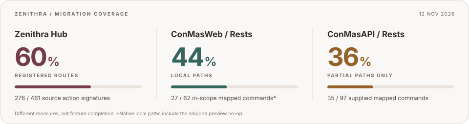

<h1>Zenithra</h1>

<strong>Same mission. New machinery. More freedom.</strong>

Recreating i-Reporter’s workflows with different code and a different composition.

  
  
  

<code>Node.js</code> &nbsp; / &nbsp; <code>Strict TypeScript</code> &nbsp; / &nbsp; <code>Express</code> &nbsp; / &nbsp; <code>EJS</code> &nbsp; / &nbsp; <code>PostgreSQL</code>

<a href="#why-zenithra">Why</a> &nbsp; · &nbsp; <a href="#where-it-stands">Progress</a> &nbsp; · &nbsp; <a href="#what-remains">Remaining work</a> &nbsp; · &nbsp; <a href="docs/api/README.md">API guide</a> &nbsp; · &nbsp; <a href="DEVELOPMENT.md">Development</a>

---

## Why Zenithra?

**A customer’s reporting workflow should not dictate their server operating system.** Zenithra is building a new foundation for familiar forms, reports, approvals and integrations—so customers can eventually run the product on non-Windows servers, including Linux, without losing the workflows they rely on.

The long-term ambition is an independently maintained product, free of CIMTOPS/ConMas runtime dependencies. **That is the destination, not today’s release.** The migration still relies on parts of a legally obtained original installation, private settings/query XML and the compatible database schema. Original clients and bundled assets also remain in use; this repository does not make proprietary components freely licensed.

> **Same goals. Different code. Different composition.** Preserve the experience first; earn the freedom to evolve it next.

## The approach

| 01 / Preserve                                                     | 02 / Recompose                                                        | 03 / Become independent                                                        |
| :---------------------------------------------------------------- | :-------------------------------------------------------------------- | :----------------------------------------------------------------------------- |
| Match workflows, original UI, permissions, errors and saved data. | Replace .NET server behavior with Node.js, TypeScript and PostgreSQL. | Remove remaining platform/vendor dependencies after compatibility is verified. |

Today’s work is **server-side**. Designer, Windows, Android and iPad clients retain their original wire contracts; their application migration has not started. Intentional redesigns come after the compatibility baseline, not instead of it.

## Where it stands

Snapshot · 12 November 2026 · Rounded coverage indicators, not production-readiness scores

| Counter                      | Calculation                      | What it actually measures                                                                                                  |
| :--------------------------- | :------------------------------- | :------------------------------------------------------------------------------------------------------------------------- |
| **ConMasManager · ≈60%**     | 276 ÷ 461 action signatures      | Registered routes, including partial handlers, blocked shells and explicit unsupported responses.                          |
| **ConMasWeb / Rests · ≈44%** | 27 ÷ 62 in-scope mapped commands | Local paths; another 27 commands are partial. Includes the supplied `GetDefinitionPreview` no-op, not a preview generator. |
| **ConMasAPI / Rests · ≈36%** | 35 ÷ 97 supplied mapped commands | **Partial** paths only; no fully migrated mapped command is claimed.                                                       |

These are **three different coverage measures**, not an overall completion estimate or comparable feature-parity scores. Percentages are rounded to the nearest whole number. Native excludes one scope-excluded command; business API excludes 12 vendor-unsupplied mappings. `/Rests` is each API's endpoint directory, not another application. Manager registration uses the verified 11 November baseline; command status includes the 12 November increments.

| Surface                         | Current evidence                                                                 | Remaining boundary                                                                                                          |
| :------------------------------ | :------------------------------------------------------------------------------- | :-------------------------------------------------------------------------------------------------------------------------- |
| **Manager** · `/ConMasManager`  | **276 / 461** source action signatures registered; **92** EJS templates/partials | **185** signatures unregistered; 5 of 11 tabs reachable, none complete                                                      |
| **Native REST** · `/ConMasWeb`  | **27 local + 27 partial** mapped commands; 7 local GeneralProcess operations     | **8** mapped commands unimplemented; 4 additional handlers and 1 GeneralProcess operation missing; 1 command scope-excluded |
| **Business API** · `/ConMasAPI` | **35 partial** mapped commands; 7 partial GeneralProcess operations              | **62** supplied mapped commands unimplemented; 12 additional mappings not supplied by the original installation             |

Manager’s baseline spans **17 controllers / 321 distinct action paths**. Native REST has **63** mapped commands; the business API has **109**, of which **97** have supplied targets. Each API has **8** separately counted GeneralProcess operations. Direct-only pages are additional work, not duplicate commands.

Registered routes include blocked shells and explicit unsupported responses. Local paths are not exhaustive compatibility; templates include partials, not just screens. There is **no verified overall completion percentage**.

### Working foundations

- **Documents:** list/detail navigation, Basic/sheet edits, supported scalar/image saves, input history, labels/permissions, normal/forced completion, numbering, approval/rejection and editable revision copies. PDF/standard CSV and stored DocuWorks downloads plus internal Excel repair have local paths; dependent pipelines remain guarded.
- **Manager tools:** System management/settings, Labels, ordinary Library workflows and CSV Data Output paths.
- **Native clients:** standard form/report transfers, definition update checks, ordinary report copying and master/catalog/library paths. Report finish commits required data transactionally; Designer-defined automatic numbering now feeds native create/edit/complete saves, read-only downloads, generated names and applicable thumbnails. `GetDocumentList` browsing/search and settings-gated `PutLog` uploads have local paths. `GetDefinitionPreview` matches the supplied authenticated empty response; it generates no preview.
- **Business integrations:** selected account, list/import/master and shared GeneralProcess paths, with separate sessions and contracts.

## What remains

- [ ] **Finish native report saves:** remaining numbering variants, journalizing, binder/pin/deferred work and required output/notification pipelines. Supported automatic numbering is wired; the separate `AutoNumbering` cluster pipeline remains unsupported. Required unsupported effects fail before success.
- [ ] **Complete Documents:** remaining cluster/application/signature/audio edits, custom/layout CSV and populated Excel exports, approval/completion dependencies, lifecycle effects and PDF audit-trail/layout/font parity. Basic revision copying is not newest-form copying.
- [ ] **Close Manager gaps:** remaining System, Labels, Library and Data Output branches, permissions/licensing, locale and original-screen parity. Six other tabs remain blocked.
- [ ] **Finish supplied APIs:** remaining mapped/direct handlers, newest-revision copying, merged PDF, authentication continuations and cross-device compatibility.
- [ ] **Prove portability and independence:** replace remaining installation-specific runtime dependencies and verify non-Windows deployment; rebuild client applications as separate future work.
- [ ] **Accept the real experience:** manual UI and unchanged-device testing across complete workflows, not just successful requests.

Scope excludes AD/MEID authentication/provider continuations and Manager’s External system linkage settings subtree. Shared user/device/license and MeID management, optional PDF license upload and native GetEdgeOCRCertificate remain in scope. Proven vendor-unsupplied features are tracked separately, never counted as completed.

> **Not a drop-in replacement yet.** Passing tests, HTTP 200 responses and one working device workflow do not establish full behavior, visual parity or production readiness.

Latest publication checks: **158 affected tests passed**, zero failures/skips, across 15 test files covering native numbering/save rollback, Designer uploads, library/log/preview behavior and shared Manager regressions. Source/test typecheck, targeted lint/format and public-document link/count/SVG checks passed. The counters measure migration coverage, not test coverage. No application rebuild/restart, full-suite run or live/browser/device acceptance was performed.

## Explore

| Start here                                        | What you’ll find                                                        |
| :------------------------------------------------ | :---------------------------------------------------------------------- |
| [Development](DEVELOPMENT.md)                     | Prerequisites, setup, architecture, storage and verification boundaries |
| [API guide](docs/api/README.md)                   | Application boundaries, sessions and protocol conventions               |
| [Native-client REST](docs/api/native-rest.md)     | Original Designer/device command paths and current limits               |
| [Business API / WebAPI](docs/api/business-api.md) | Separate integration commands and unfinished branches                   |
| [Database bootstrap](database/README.md)          | Original base backups, provenance and safe preparation                  |

---

Zenithra is an independent project, not an official CIMTOPS/i-Reporter release. Included original assets and base database files retain their licensing terms. Vendor executables, licenses, decompiled sources, private evidence, credentials and live customer data stay local and Git-ignored. Use only installations and data you are authorized to access.
