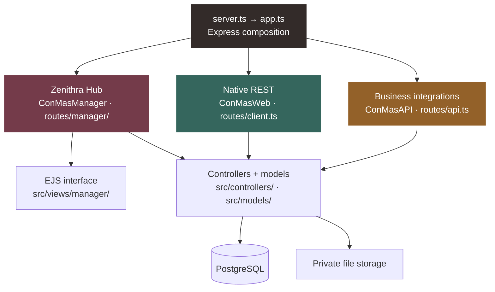

<h1>Zenithra</h1>

<strong>Same mission. New machinery. More freedom.</strong>

Rebuilding i-Reporter’s server workflows for a more portable future—without changing the clients.

  
  

<code>Node.js</code> &nbsp; / &nbsp; <code>Strict TypeScript</code> &nbsp; / &nbsp; <code>Express</code> &nbsp; / &nbsp; <code>EJS</code> &nbsp; / &nbsp; <code>PostgreSQL</code>

<a href="#where-it-stands">Progress</a> &nbsp; · &nbsp; <a href="#code-graph">Code graph</a> &nbsp; · &nbsp; <a href="#what-remains">Next milestones</a> &nbsp; · &nbsp; <a href="docs/api/README.md">API guide</a> &nbsp; · &nbsp; <a href="DEVELOPMENT.md">Development</a>

---

## Where it stands

12 November 2026 · Different coverage measures, not overall completion. <a href="docs/api/README.md#what-migration-status-means">Counting rules and detailed status →</a>

### Latest progress

- **Zenithra Hub** — the ConMas Manager replacement: Documents list/detail, Basic and sheet edits, completion, approval and revision-copy paths; System, Labels, Library and Data Output are reachable but incomplete.
- **Native saves** — transactional report persistence and Designer-defined automatic numbering, including generated names, read-only fields and applicable thumbnails.
- **Native commands** — document browsing/search (`GetDocumentList`) and private client-log uploads (`PutLog`). `GetDefinitionPreview` matches the supplied empty-response placeholder; it does not generate previews.
- **Business integrations** — 35 mapped commands have partial paths, with separate authentication from native clients and Hub.

**Latest implementation checks:** 158 affected tests passed; typecheck, targeted lint/format and documentation integrity passed. [Verification details →](DEVELOPMENT.md#focused-native-migration-checks)

## Code graph

Zenithra contains all three applications. Each has its own session; selected business helpers and persistence are shared.

## What remains

- [ ] **Finish native dependencies:** binder/journalizing, pin/deferred generation, remaining numbering, output and notifications; close 13 missing native entry points.
- [ ] **Complete Hub workflows:** remaining Documents edits/exports, Manager branches and original-screen parity. Six other tabs remain blocked.
- [ ] **Expand business API coverage:** finish partial paths and the remaining supplied commands.
- [ ] **Prove portability and compatibility:** reduce installation dependencies and verify complete workflows with unchanged Designer, Windows, Android and iPad clients.

> **Still a migration, not a production-ready drop-in replacement.** Required unsupported save effects fail before success; original-installation dependencies and real-client acceptance remain.

## Explore

[Development](DEVELOPMENT.md) · [Native REST](docs/api/native-rest.md) · [Business API](docs/api/business-api.md) · [Database setup](database/README.md)

---

Zenithra is an independent project, not an official CIMTOPS/i-Reporter release. Included original assets and base database files retain their licensing terms. Vendor executables, licenses, decompiled sources, private evidence, credentials and live customer data stay local and Git-ignored. Use only installations and data you are authorized to access.
