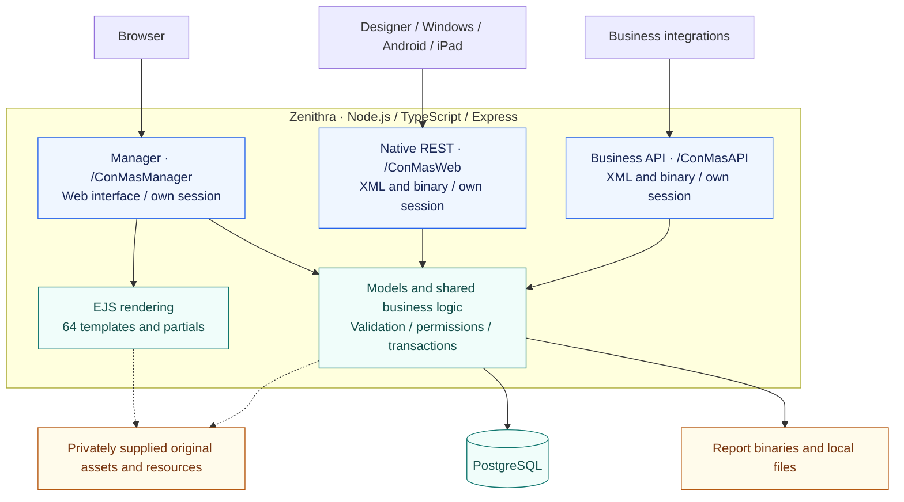

<div align="center">

<h1>Zenithra</h1>
<p><strong>A new foundation. The same behavior first.</strong></p>
<p>Migrating i-Reporter’s .NET server applications to Node.js and TypeScript.</p>

<p>
  
  
  
</p>

<p><code>Node.js</code> &nbsp; / &nbsp; <code>Strict TypeScript</code> &nbsp; / &nbsp; <code>Express</code> &nbsp; / &nbsp; <code>EJS</code> &nbsp; / &nbsp; <code>PostgreSQL</code></p>

<p><a href="#architecture">Architecture</a> &nbsp; · &nbsp; <a href="#migration-by-the-numbers">Numbers</a> &nbsp; · &nbsp; <a href="#migration-progress">Progress</a> &nbsp; · &nbsp; <a href="#next-milestones">Next milestones</a> &nbsp; · &nbsp; <a href="#development">Development</a></p>

</div>

---

## The migration contract

**Match the original before changing it.** Zenithra is currently a compatibility migration, not a redesign. The installed .NET application remains the reference for default behavior, layout, JavaScript, CSS, icons, permissions, licensing, errors and persistence. Existing Designer and device clients should retain their wire contracts.

<table>
  <tr>
    <th align="left">01 / Preserve</th>
    <th align="left">02 / Verify</th>
    <th align="left">03 / Evolve</th>
  </tr>
  <tr>
    <td>Reproduce the original workflows, screens and side effects in the new stack.</td>
    <td>Check behavior, transactions, protocol responses and visual acceptance separately.</td>
    <td>Introduce intentional design and functional changes only after parity is verified.</td>
  </tr>
</table>

## Architecture



Three application surfaces share selected business helpers and storage—not authentication sessions. The original .NET installation is the compatibility reference, not a fourth public application bundled in this repository.

## Migration by the numbers

<sub>Rechecked: 8 November 2026 · Source actions, installed templates, current route registration and reviewed command inventories</sub>

<table>
  <tr>
    <th align="left">Surface</th>
    <th align="left">Functions / actions inventoried</th>
    <th align="left">Current migration state</th>
    <th align="left">Views / pages</th>
  </tr>
  <tr>
    <td><strong>Manager</strong><br><code>/ConMasManager</code></td>
    <td><strong>461</strong> action signatures<br><strong>321</strong> distinct action paths<br><strong>17</strong> source controllers</td>
    <td><strong>250</strong> source signatures have matching Node routes<br><strong>211</strong> remain unregistered<br><strong>5 / 11</strong> menu tabs reachable; none claimed complete</td>
    <td><strong>252</strong> installed Razor templates<br><strong>64</strong> current Node EJS templates/partials</td>
  </tr>
  <tr>
    <td><strong>Native-client REST</strong><br><code>/ConMasWeb</code></td>
    <td><strong>63</strong> mapped commands<br><strong>8</strong> GeneralProcess operations</td>
    <td>Mapped commands: <strong>23</strong> local paths, <strong>27</strong> partial, <strong>12</strong> unimplemented, <strong>1</strong> scope-excluded<br>GeneralProcess: <strong>7</strong> local paths, <strong>1</strong> unimplemented</td>
    <td><strong>74</strong> installed ASPX entry pages<br><strong>3</strong> static HTM pages<br><strong>0</strong> EJS views; XML/binary API</td>
  </tr>
  <tr>
    <td><strong>Business API / WebAPI</strong><br><code>/ConMasAPI</code></td>
    <td><strong>109</strong> mapped commands<br><strong>97</strong> mapped targets actually supplied<br><strong>8</strong> GeneralProcess operations</td>
    <td>Mapped commands: <strong>35</strong> partial, <strong>62</strong> unimplemented, <strong>12</strong> not supplied by the original installation<br>GeneralProcess: <strong>7</strong> partial, <strong>1</strong> unimplemented</td>
    <td><strong>109</strong> deployed ASPX entry pages, including direct-only pages and dispatcher<br><strong>2</strong> HTM pages + <strong>1</strong> static JS asset<br><strong>0</strong> EJS views; XML/binary API</td>
  </tr>
</table>

**How to read these counts:** “Function” here means a public action signature or mapped command—not every internal helper. GET/POST overloads count separately. Manager registration includes blocked shells and explicit unsupported handlers; it is **not** 250 completed functions. Razor/EJS totals include partials and layouts, so **64 / 252 is not a screen-completion ratio**. Same-name API pages are alternate entry points, not extra commands. GeneralProcess operations are counted separately; unavailable targets and scope exclusions are not completed work.

<details>
<summary><strong>Manager breakdown · actions, registration gaps and original views</strong></summary>

| Controller / area             | Source actions | Registered | Unregistered | Original Razor templates |
| :---------------------------- | -------------: | ---------: | -----------: | -----------------------: |
| Account                       |              8 |          4 |            4 |                        8 |
| Doc. Import / AutoGenerate    |             14 |          1 |           13 |                        5 |
| Binder                        |             11 |          1 |           10 |                        9 |
| Common / shared actions       |             28 |          7 |           21 |                       19 |
| Master Manager / CustomMaster |             14 |          1 |           13 |                        6 |
| Custom menu                   |             11 |          1 |           10 |                        4 |
| Data Output                   |             18 |         18 |            0 |                        9 |
| Forms / DefReport             |             71 |          2 |           69 |                       40 |
| FreeDrawOnly                  |              1 |          0 |            1 |                        0 |
| Help                          |              8 |          0 |            8 |                        1 |
| **Documents / InputReport**   |         **67** |     **15** |       **52** |                   **31** |
| Labels                        |             10 |         10 |            0 |                        5 |
| Library                       |             19 |         19 |            0 |                        9 |
| Schedule                      |              8 |          1 |            7 |                        4 |
| Standard dialogs              |              3 |          0 |            3 |                        1 |
| System                        |            169 |        169 |            0 |                       86 |
| SystemGoogleAuthCallback      |              1 |          1 |            0 |                        0 |
| **Controller totals**         |        **461** |    **250** |      **211** |                  **237** |

Another **15** templates belong to Shared, Home, Sample and the root layout, bringing the installed total to **252**. The **64** EJS files are independently counted from `src/views/manager/`; shared dialogs may serve multiple controllers. System's baseline includes **25** excluded linkage-setting actions; its callback is also excluded. Full baseline counts are retained for traceability, not used as an in-scope completion percentage.

The registration check constructs the app with a throw-on-query/connect database stub and inspects routes: **zero database calls, no listener, no live-server requests**. Native/API status labels come from reviewed command inventories checked against the current configuration; they are not a fresh end-to-end acceptance result.

</details>

## Migration progress

<sub>Snapshot: 8 November 2026 · Current priority: Manager Documents Index</sub>

### Server-side indicators

<table>
  <tr>
    <th align="left">Component</th>
    <th align="left">Approximate indicator</th>
    <th align="left">What the percentage measures</th>
  </tr>
  <tr>
    <td><strong>Manager server</strong></td>
    <td><strong>≈54%</strong> route registration</td>
    <td>250 / 461 source action signatures have matching Node routes. Includes partial, blocked and explicitly unsupported handlers—not completed workflows.</td>
  </tr>
  <tr>
    <td><strong>Native REST server</strong></td>
    <td><strong>≈81%</strong> with local or partial paths</td>
    <td>(23 local + 27 partial) / 62 in-scope mapped commands have some migrated implementation. The single scope-excluded command is omitted; direct-only handlers and GeneralProcess are tracked separately.</td>
  </tr>
  <tr>
    <td><strong>Business API / WebAPI server</strong></td>
    <td><strong>≈36%</strong> with partial paths</td>
    <td>35 / 97 supplied mapped commands have partial implementations. Twelve unavailable targets are omitted; direct-only handlers and GeneralProcess are tracked separately.</td>
  </tr>
</table>

**These are coverage indicators, not “percent finished.”** Manager uses the full source-action baseline; native REST and the business API use their respective eligible mapped commands. Their denominators and maturity differ, so they are not averaged into an overall server-completion score. Full behavior, UI parity, permissions, licensing and acceptance remain unfinished.

### Client application migration

| Application     | Migration | Current state                                                         |
| :-------------- | --------: | :-------------------------------------------------------------------- |
| **Windows app** |    **0%** | Application migration not started; original client remains unchanged. |
| **Android app** |    **0%** | Application migration not started; original client remains unchanged. |
| **Designer**    |    **0%** | Application migration not started; original client remains unchanged. |

Working server communication with an existing client does **not** mean that client application has been migrated. Current implementation work is server-side; these 0% figures describe the separate client applications, not server endpoint coverage.

### Feature-level progress

**All areas below remain partial.** “Available” identifies implemented paths, not full feature parity. There is no verified overall completion percentage yet.

<table>
  <tr>
    <th align="left">Area</th>
    <th align="left">Available in the migration</th>
    <th align="left">Still to finish</th>
  </tr>
  <tr>
    <td><strong>Documents</strong><br><sub>Active priority</sub></td>
    <td>Index filtering, sorting and paging; label navigation/linking; app launch; deletion lifecycle; identification checks; task picker/registration; protected media and FreeDraw detail view.</td>
    <td>Approval persistence, Manager report copying, main Details workflows, deletion edge parity, notification delivery and complete visual/locale acceptance.</td>
  </tr>
  <tr>
    <td><strong>System</strong></td>
    <td>Management/settings modules, users, groups, devices, imports/exports, licensing/storage controls, Webhook settings and logs.</td>
    <td>Remaining import branches, optional PDF-license integration and exhaustive permission, licensing and screen parity.</td>
  </tr>
  <tr>
    <td><strong>Labels</strong></td>
    <td>Seven modes, hierarchy, create/edit/delete, permissions, copying and shared selectors.</td>
    <td>Shared layout, locale, selector edge cases and manual UI acceptance.</td>
  </tr>
  <tr>
    <td><strong>Library</strong></td>
    <td>Ordinary file/URL/image workflows, replacement/rollback, labels/roles, downloads and IRFD image/text/GPS extraction.</td>
    <td>FreeDraw registration/locks, linked forms/reports and remaining behavior, audit and UI branches.</td>
  </tr>
  <tr>
    <td><strong>Data Output</strong></td>
    <td>Form/report selection, saved layouts, confirmation and ordinary CSV ZIP export.</td>
    <td>Cooperation views, automatic output, PDF/Excel/image bundles and special sheet/field branches.</td>
  </tr>
  <tr>
    <td><strong>Native-client REST</strong></td>
    <td>Standard form/report transfers, transactional saves, ordinary copying, masters, catalog/library and selected GeneralProcess workflows.</td>
    <td>Remaining commands, direct handlers, advanced report pipelines, merged PDF and exhaustive client/locale compatibility.</td>
  </tr>
  <tr>
    <td><strong>Business API</strong></td>
    <td>Account, list/import/master paths and shared GeneralProcess workflows.</td>
    <td>Many mapped commands and branches; the separate DocumentRegistration command and unresolved deployed-source gaps.</td>
  </tr>
</table>

> **Not a drop-in replacement yet.** Unfinished workflows may explicitly reject requests. Registered routes, HTTP 200 responses and passing tests are not evidence of complete behavioral or visual parity. Other Manager tabs remain blocked rather than being presented as finished.

## Next milestones

- [ ] **Finish Documents Index end to end** — complete visible controls and their required transactional side effects.
- [ ] **Complete approval, copy and Details** — preserve report state, permissions, binaries and downstream effects before reporting success.
- [ ] **Accept the original UI** — recheck tables, headers, menus, assets, dialogs and locale against the installed application; manual Edge UAT at 80% zoom remains outstanding.
- [ ] **Resume Library and Data Output** — close their remaining branch and workflow gaps after the Documents Index priority.
- [ ] **Close native/API compatibility gaps** — finish remaining supplied commands and verify unchanged client contracts.
- [ ] **Consider redesigns** — only after the compatibility baseline is verified.

## Application surfaces

| Application            | Base path        | Compatibility boundary                            |
| :--------------------- | :--------------- | :------------------------------------------------ |
| **Manager**            | `/ConMasManager` | Web management and document workflows             |
| **Native-client REST** | `/ConMasWeb`     | Designer, Windows, Android and iPad communication |
| **Business API**       | `/ConMasAPI`     | Separate business API sessions and contracts      |

These are separate application surfaces, not aliases. Migration scope excludes AD/MEID authentication and the Manager External system linkage settings subtree; shared user/device/license management and native GetEdgeOCRCertificate remain in scope.

## Development

<details>
<summary><strong>Local setup and prerequisites</strong></summary>

A fresh clone is **not self-contained**. Some compatibility paths still load private original resources, query XML and views; workstation-specific paths are not fully portable yet.

Required:

- Node.js supporting the project's `node --watch` workflow and pnpm **10.30.3**.
- PostgreSQL with a separately prepared compatible schema and authorized data.
- Your own legally obtained original installation and required local assets/resources.
- A private `.env` based on [`.env.example`](.env.example), with database access, a strong session secret and your installation's compatibility keys.

After those prerequisites are prepared:

```sh
pnpm install --frozen-lockfile
pnpm dev
```

Manager login: `http://127.0.0.1:3000/ConMasManager/Account/LogOn`.

Do not start another server on an occupied port. Sessions and unfinished transfer staging are process-local; restarting can interrupt them.

**Database preparation is separate.** Review `pnpm db:prepare` before applying changes. `pnpm import:samples` writes forms/documents and is not a setup shortcut for customer databases. This snapshot does not include a clean-install database bootstrap.

</details>

<details>
<summary><strong>Checks and acceptance boundaries</strong></summary>

```sh
pnpm typecheck
pnpm lint
pnpm format:check
pnpm test
```

Database-backed checks need private configuration and may otherwise skip; some checks also require excluded original resources. Use isolated fixtures, never customer-data changes. `pnpm build` emits production JavaScript to `dist/`, but building does not establish parity. Do not rebuild, restart or replay live requests just to verify documentation.

</details>

<details>
<summary><strong>Source layout</strong></summary>

```text
src/
  config/         Configuration readers
  controllers/    Request handlers
  middleware/     Authentication and request security
  models/         Business logic and persistence
  routes/         Route registration
  services/       Rendering and application services
  shared/         Shared protocol utilities
  views/          EJS templates
test/             Layer-specific and integration checks
config/           Native-client and business-API configuration
```

Manager MVC stays layer-first: `src/controllers/manager/<menu>/`, `src/models/manager/<menu>/` and `src/views/manager/<menu>/`.

</details>

---

<sub><strong>Public source, private prerequisites.</strong> This repository includes the migration implementation, templates, configuration and tests—not original vendor assets, binaries, licenses, decompiled projects, private evidence, customer data, backups or credentials. These remain local and Git-ignored. Use only installations and data you are authorized to access. Zenithra is an independent project, not an official i-Reporter release; publication grants no rights to proprietary components.</sub>
